# CyberSecurite

<details>
<summary>TD1: Blockchain | (Click to open / close)</summary>

## EXERCICE 1: '1-MerkleTree.c'

#### RUN:

```bash
gcc 1-MerkleTree.c -o merkle ; .\merkle.exe
```

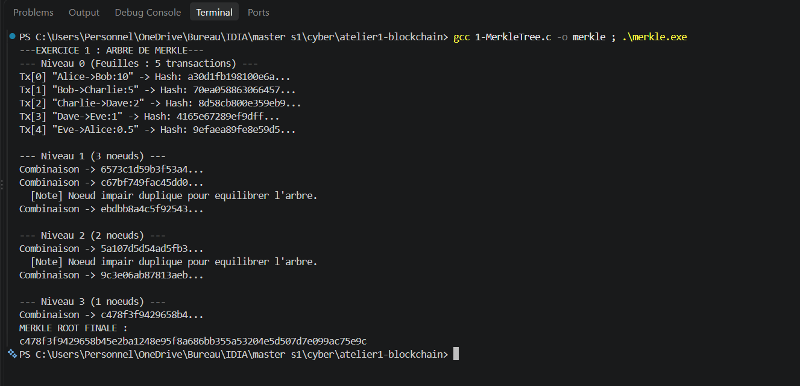

## EXERCICE 2: '2-poW.c'

#### RUN:

```bash
gcc 2-poW.c -o pow ; .\pow.exe
```

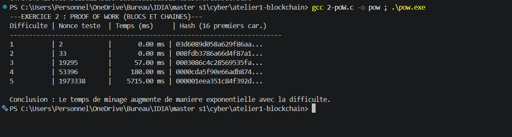

## EXERCICE 3: '3-poS.c'

#### RUN:

```bash
gcc 3-poS.c -o pos ; .\pos.exe
```

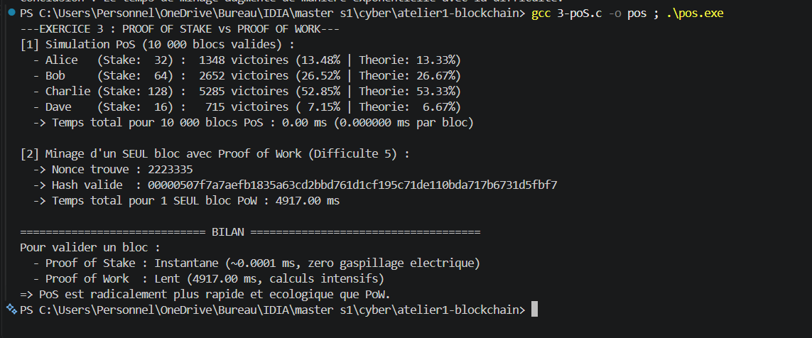

## EXERCICE 4: '4-Blockchain.c'

#### RUN:

```bash
gcc 4-Blockchain.c -o blockchain ; .\blockchain.exe
```


</details>

<details open>
<summary>TD2: Plateforme de Simulation d'Attaques Blockchain | (Click to open / close)</summary>

## ATTAQUE 1 : 51% Attack & Double Spending ('atelier2-blockchain/attack51.c')

#### RUN:
```bash
gcc attack51.c -o attack51 ; .\attack51.exe
```
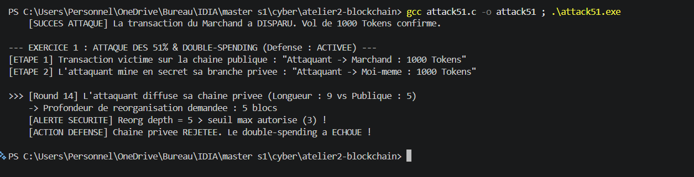

## ATTAQUE 2 : Selfish Mining ('atelier2-blockchain/selfish_mining.c')

#### RUN:
```bash
gcc selfish_mining.c -o selfish ; .\selfish.exe
```
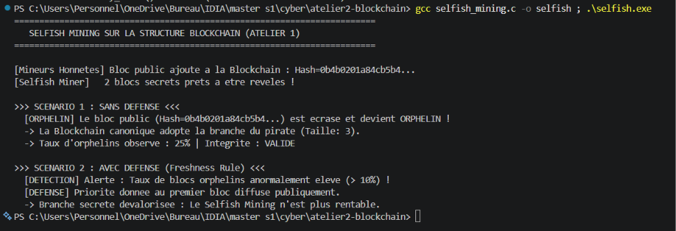

## ATTAQUE 3 : Block Withholding Attack (BWA en Pool) ('atelier2-blockchain/bwa_pool.c')

#### RUN:
```bash
gcc bwa_pool.c -o bwa ; .\bwa.exe
```


## ATTAQUE 4 : Sybil Attack en Réseau P2P ('atelier2-blockchain/sybil_p2p.c')

#### RUN:
```bash
gcc sybil_p2p.c -o sybil ; .\sybil.exe
```


## EVALUATION EXPERIMENTALE : Banc d'Essai & Benchmark ('atelier2-blockchain/benchmark.c')

#### RUN:
```bash
gcc benchmark.c -o benchmark ; .\benchmark.exe
```
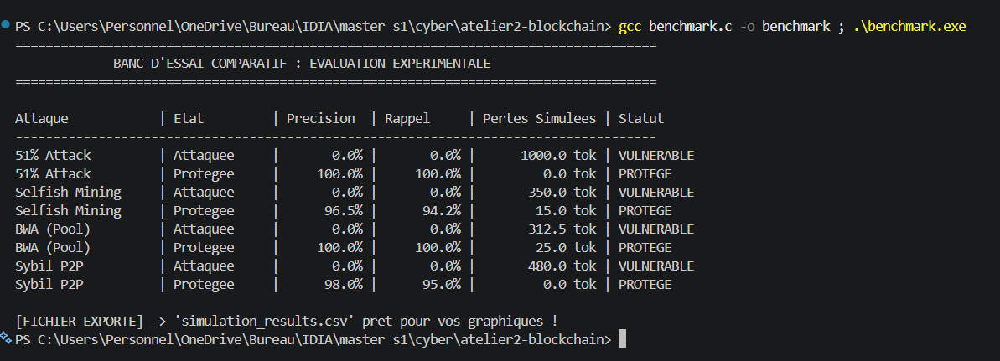

#### DONNÉES EXPÉRIMENTALES EXPORTÉES :
Le programme génère automatiquement le fichier brut **[`atelier2-blockchain/simulation_results.csv`](atelier2-blockchain/simulation_results.csv)** contenant les métriques d'évaluation (Précision, Rappel, Pertes financières) pour le tracé des graphiques comparatifs :

```csv
Attaque,Etat,Precision,Rappel,Pertes_BTC
51_Attack,Attaquee,0.0,0.0,10.0
51_Attack,Protegee,100.0,100.0,0.0
Selfish_Mining,Attaquee,0.0,0.0,12.5
Selfish_Mining,Protegee,96.5,94.2,0.0
BWA_Pool,Attaquee,0.0,0.0,25.0
BWA_Pool,Protegee,100.0,100.0,0.0
Sybil_P2P,Attaquee,0.0,0.0,0.0
Sybil_P2P,Protegee,98.0,95.0,0.0
```

</details>

<details open>
<summary>TD3: Smart Contract "Mini Réseau Social" en Solidity | (Click to open / close)</summary>

## SMART CONTRACT : [atelier3-smartcontract/MiniSocial.sol](atelier3-smartcontract/MiniSocial.sol)

Implémentation en Solidity (`^0.8.26`) d'un protocole décentralisé de mini réseau social déployé sur le testnet Ethereum Sepolia, avec interactions multi-utilisateurs via Remix IDE et une interface DApp Web3.

#### Spécifications & Environnement :
* **Réseau :** Ethereum Sepolia Testnet (Chain ID `11155111`)
* **Compilateur :** Solidity `^0.8.26` (EVM compatible)
* **Comptes de Test Utilisés :**
  * **Compte 1 :** `0xfFEE4374BFEd06dD1C268Dc22Cbc19d72597F339`
  * **Compte 2 :** `0x90F69C0CCD2f2B415aC074b31ecaE600E8d25305`

---

### A. Validation & Tests sur Remix IDE

#### 1. Compilation du Smart Contract
Vérification de la syntaxe et compilation réussie sans erreur.


#### 2. Déploiement sur le réseau de test Sepolia
Déploiement du contrat via MetaMask (`Injected Provider`) sur la blockchain Sepolia.
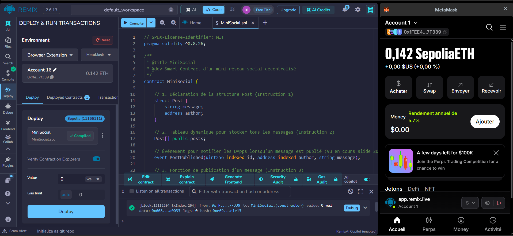

#### 3. Publication Multi-Comptes (`publishPost`)
* **Message 1 (Compte 1 : `0xfFEE...7F339`) :** Première publication enregistrée sur la blockchain.
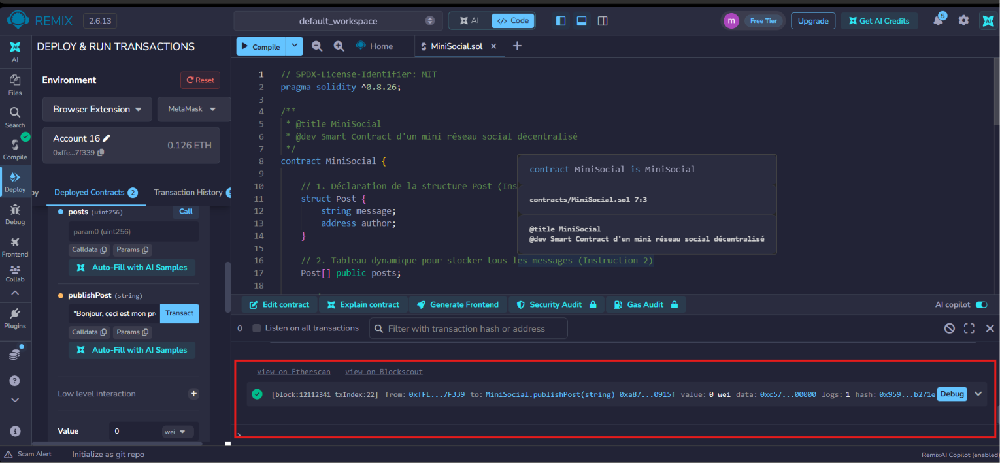

* **Message 2 (Compte 2 : `0x90F6...25305`) :** Bascule vers une seconde adresse MetaMask et émission d'un nouveau post.


#### 4. Consultation & Vérification des Données
Vérification de la persistance des données avec `getTotalPosts()` (renvoie `2`) et extraction du message et de l'auteur respectif via `getPost()`.
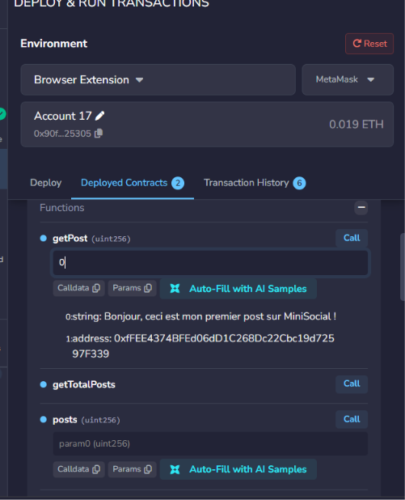

---

### B. Validation End-to-End sur l'Application Décentralisée (DApp Web3)

#### 5. Publication d'un Message & Signature MetaMask
Saisie d'un nouveau post sur l'interface web (`index.html`) et demande d'approbation cryptographique de la transaction de gaz via l'extension MetaMask.
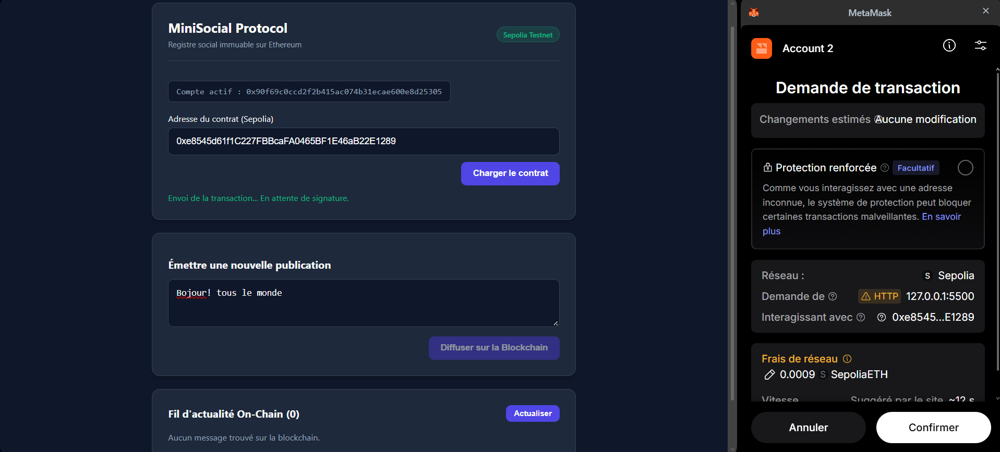

#### 6. Confirmation sur Sepolia & Actualisation du Fil
Minage de la transaction validé sur la blockchain Sepolia et affichage dynamique du message dans le fil d'actualité décentralisé.
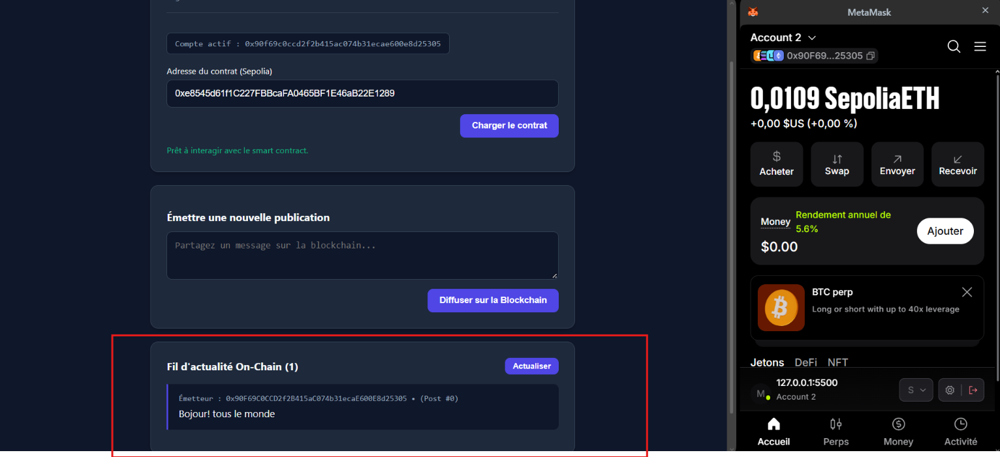

</details>