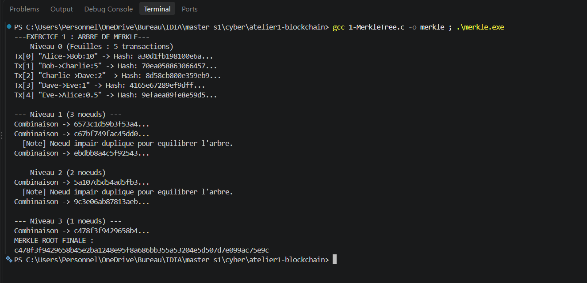
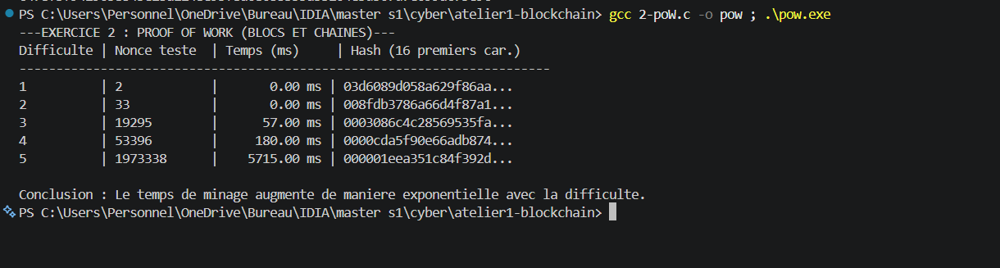
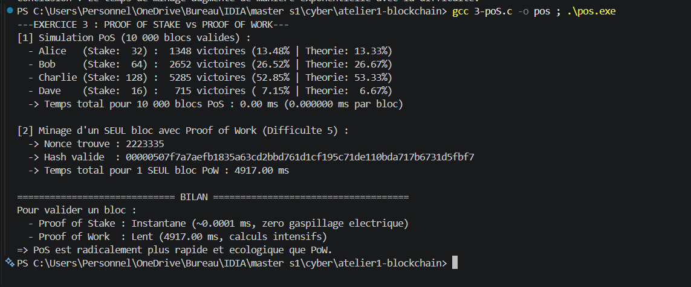
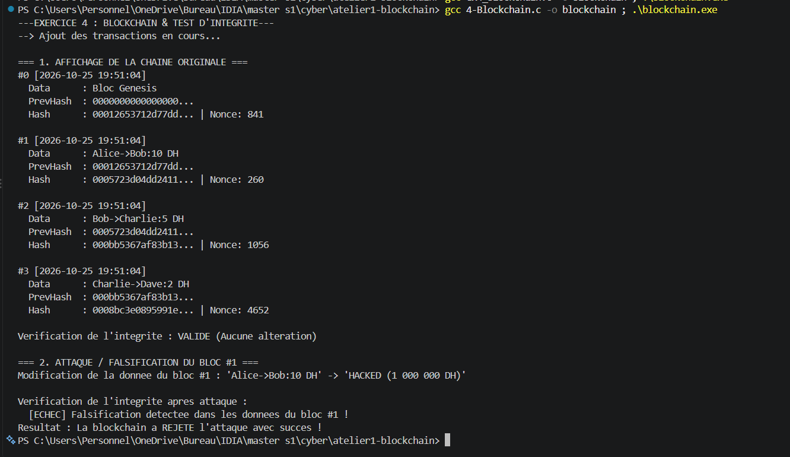
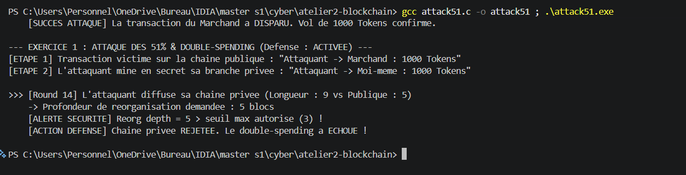
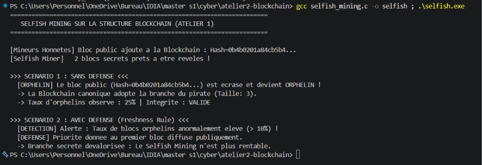
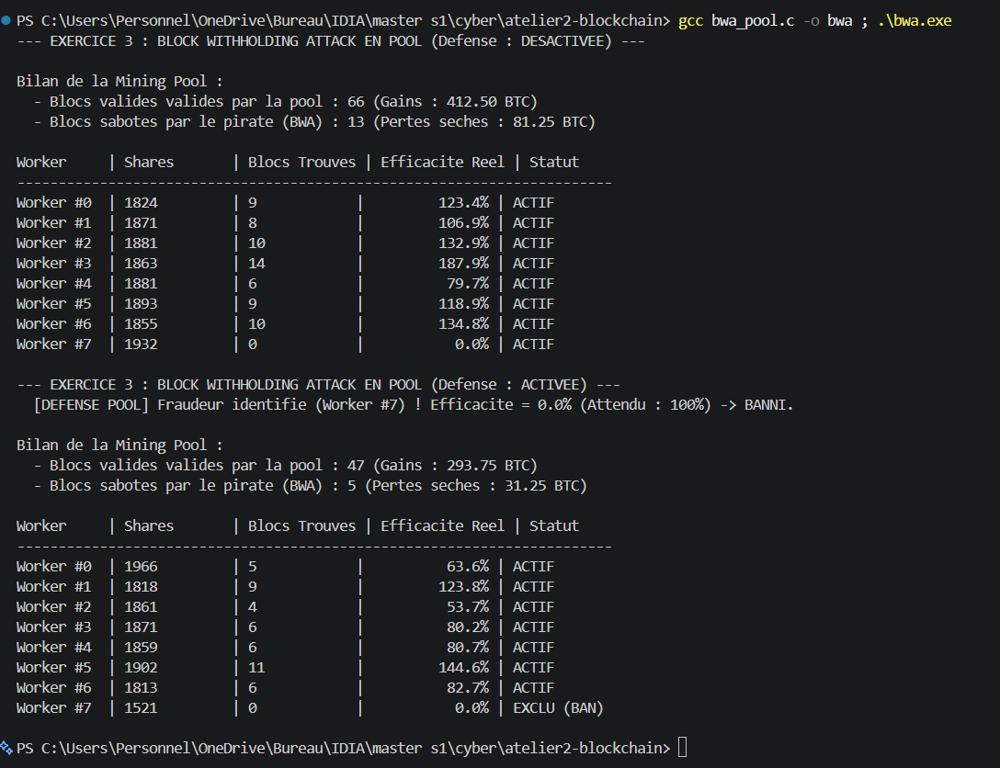
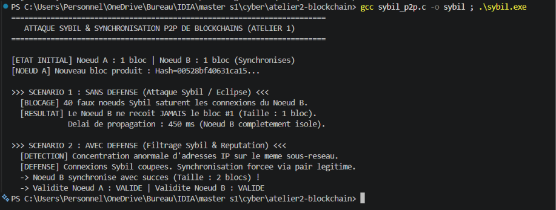
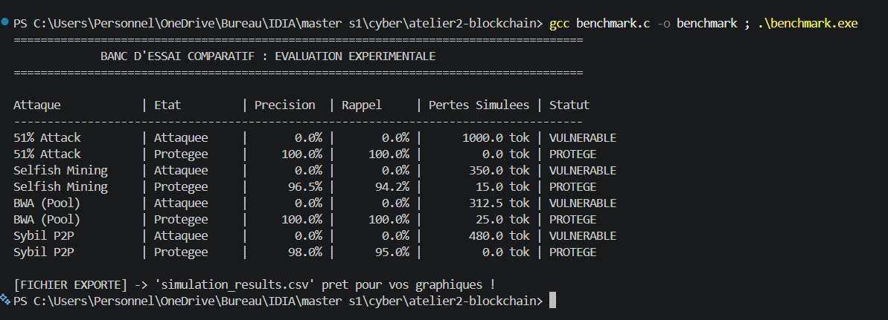

# CyberSecurite

<details>
<summary>TD1: Blockchain | (Click to open / close)</summary>

## EXERCICE 1: '1-MerkleTree.c'

#### RUN:

```bash
gcc 1-MerkleTree.c -o merkle ; .\merkle.exe
```



## EXERCICE 2: '2-poW.c'

#### RUN:

```bash
gcc 2-poW.c -o pow ; .\pow.exe
```



## EXERCICE 3: '3-poS.c'

#### RUN:

```bash
gcc 3-poS.c -o pos ; .\pos.exe
```



## EXERCICE 4: '4-Blockchain.c'

#### RUN:

```bash
gcc 4-Blockchain.c -o blockchain ; .\blockchain.exe
```




</details>

<details open>
<summary>TD2: Plateforme de Simulation d'Attaques Blockchain | (Click to open / close)</summary>

## ATTAQUE 1 : 51% Attack & Double Spending ('atelier2-blockchain/attack51.c')

#### RUN:
```bash
gcc attack51.c -o attack51 ; .\attack51.exe
```


## ATTAQUE 2 : Selfish Mining ('atelier2-blockchain/selfish_mining.c')

#### RUN:
```bash
gcc selfish_mining.c -o selfish ; .\selfish.exe
```


## ATTAQUE 3 : Block Withholding Attack (BWA en Pool) ('atelier2-blockchain/bwa_pool.c')

#### RUN:
```bash
gcc bwa_pool.c -o bwa ; .\bwa.exe
```


## ATTAQUE 4 : Sybil Attack en Réseau P2P ('atelier2-blockchain/sybil_p2p.c')

#### RUN:
```bash
gcc sybil_p2p.c -o sybil ; .\sybil.exe
```


## EVALUATION EXPERIMENTALE : Banc d'Essai & Benchmark ('atelier2-blockchain/benchmark.c')

#### RUN:
```bash
gcc benchmark.c -o benchmark ; .\benchmark.exe
```


#### DONNÉES EXPÉRIMENTALES EXPORTÉES :
Le programme génère automatiquement le fichier brut **[`atelier2-blockchain/simulation_results.csv`](atelier2-blockchain/simulation_results.csv)** contenant les métriques d'évaluation (Précision, Rappel, Pertes financières) pour le tracé des graphiques comparatifs :

```csv
Attaque,Etat,Precision,Rappel,Pertes_Tokens
51_Attack,Attaquee,0.0,0.0,1000.0
51_Attack,Protegee,100.0,100.0,0.0
Selfish_Mining,Attaquee,0.0,0.0,350.0
Selfish_Mining,Protegee,96.5,94.2,15.0
BWA_Pool,Attaquee,0.0,0.0,312.5
BWA_Pool,Protegee,100.0,100.0,25.0
Sybil_P2P,Attaquee,0.0,0.0,480.0
Sybil_P2P,Protegee,98.0,95.0,0.0
```

</details>